<div align="center">

# ⚔️ Kafra

**An adventurer's guide to watching your AI coding agents**

*Every repo is a town. Every agent is a character. Watch them build, live or replayed.*

[](https://github.com/isha93/kafra/actions/workflows/test.yml)


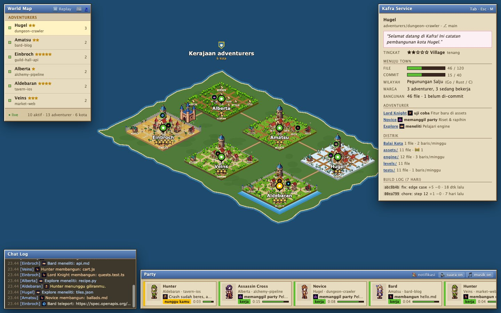

</div>

> *"Welcome to Kafra Service! We look after adventurers in every town of
> Rune-Midgard: storage, teleports, save points."* Here, the adventurers are
> your Claude Code, Codex and Gemini agents, and the towns are your repos.

Running several agents at once means hopping between terminals to find out who
is working, who is waiting for you, and whose context is about to run out.
Kafra puts all of them on one map. You can rewind the day to see what happened
while you were away, and get a ping the moment someone needs you.

**Everything runs on your machine.** Kafra reads the session files your agents
already write, plus git. It never calls a model, spends no tokens, installs
nothing into your agents, and makes no network calls. There's no
`npm install` either.

---

## 📜 Quest 1: Enter the world

> **Requirements:** Node 20+ · git · a terminal. Tested on macOS and Linux
> (Node 20, 22 and 24); on Windows, use WSL. The menu bar, notifier and
> autostart are macOS-only.

```bash
brew install isha93/tap/kafra
kafra
```

Or with npm: `npx @isha93/kafra` to try it, or `npm install -g @isha93/kafra`
and then `kafra`. Use an installed copy for autostart and the menu bar, since
`npx` runs from a cache npm may clear.

Or straight from the source, no install:

```bash
git clone https://github.com/isha93/kafra.git
cd kafra
./kafra.sh
```

Installed with Homebrew or npm, the command is `kafra`; in a clone it's `./kafra.sh`.
Everything below works with either.

- [ ] Your browser opens **http://127.0.0.1:4317**: every repo with an agent becomes a town.
- [ ] Click an agent to see its quest, HP and recent actions.
- [ ] Press `M` to see the whole world, and `Tab` to hop between agents.

**Side quests**

| Command | Reward |
|---|---|
| `./kafra.sh demo` | a sample town showing every animation → `:4318` |
| `./kafra.sh simulate` | six fake towns with ten agents, working forever → `:4319` |
| `./kafra.sh public` | your world with every word removed, safe for streaming |
| `./kafra.sh menubar` | `⚔ 2` in your macOS menu bar, and native notifications |
| `./kafra.sh autostart on` | Kafra opens by itself whenever you log in to your Mac |
| `./kafra.sh clean` | sweep away Kafra's temporary files |

**Controls**

| Input | Action |
|---|---|
| Drag / scroll | pan / zoom |
| Click | details for an agent, building, town or the Kafra booth |
| `Tab` | next active agent; the camera follows until you drag |
| `M` | world map |
| `R` / `Space` | open replay / play–pause |
| `Esc` | clear selection, close the newspaper, leave replay |
| 🌐 | switch between English and Bahasa Indonesia |

**Language.** Kafra speaks English and Bahasa Indonesia. It follows your
system language, and you can switch with 🌐 (remembered per browser), add
`?lang=id` to the URL, or set `KAFRA_LANG=id` for the terminal and menu bar.

---

## 🗺️ The world of Rune-Midgard

| Your world | In Kafra |
|---|---|
| GitHub owner | 🏝️ **Kingdom**: its own island (repos without a remote live in *Tanah Liar*) |
| Git repo | 🏘️ **Town**, with a Rune-Midgard name that stays the same |
| Top-level folder (`src/`, `web/`) | 🏠 **District building** |
| Uncommitted files | 🚧 **Scaffolding** on that building |
| A new commit | 🎆 Fireworks and **"Level Up!"** in the plaza |
| Agent session | 🧙 **Character**, whose HP bar is its remaining context |
| Subagent | 👥 **Party member**, beside its leader |

## 🛡️ Class roster

The tool picks the family and the model picks the rank, so you can tell
Claude from Codex from Gemini, and Opus from Haiku, at a glance.

| | Class | Agent |
|:-:|---|---|
| 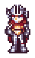 | **Lord Knight** | Claude Opus |
| 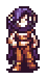 | **Assassin Cross** | Claude Sonnet |
| 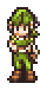 | **Hunter** | Claude Haiku |
| 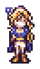 | **Bard** | Claude Fable |
| 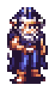 | **Wizard** | Codex (CLI and Desktop) |
| 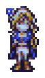 | **Sage** | Gemini CLI |
| 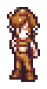 | **Novice** | any model Kafra doesn't recognise |
| 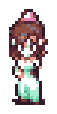 | *Kafra attendant* | an NPC at every booth; click the booth for the town's build log |

## ✨ Skills

What an agent does decides where it walks and what it plays.

| | Skill | Triggered by | Where and how |
|:-:|---|---|---|
| 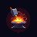 | **Build** | Edit, Write, `apply_patch` | at the district that owns the file: hammer, sparks |
|  | **Research** | Read, Grep, Glob | library: book, floating pages |
| 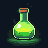 | **Craft** | shell commands | workshop: flask, smoke |
|  | **Training** | running tests | arena: damage numbers, a red **Miss** on failure |
| 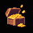 | **Deliver** | `git commit` / `push` | the Kafra booth, carrying a chest |
|  | **Teleport** | web search / fetch | warp portal: pillar of light |
| 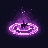 | **Summon** | starting a subagent | a magic circle, then a party member appears |
|  | **Cast** | thinking | in place, with "…" |
| 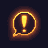 | **Your turn!** | its turn ended | plaza: a "!" above its head |
|  | **Rest** | 30+ minutes quiet | at the inn |

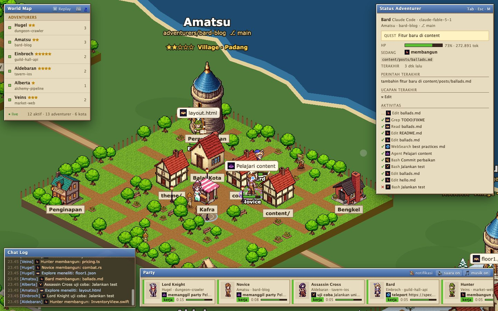

## 🏰 Town levels

Towns grow with the repo. The tier comes from file count, commit count and age
(`src/growth.mjs`), and the commit floor stops a huge one-off import from
skipping tiers.

<div align="center">
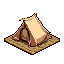&nbsp;&nbsp;→&nbsp;&nbsp;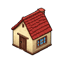&nbsp;&nbsp;→&nbsp;&nbsp;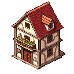&nbsp;&nbsp;→&nbsp;&nbsp;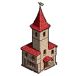&nbsp;&nbsp;→&nbsp;&nbsp;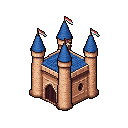
</div>

| Tier | To reach it | Looks like |
|---|---|---|
| ★ **Camp** | a new repo | tents, a campfire, dirt paths |
| ★★ **Village** | 25 files · 10 commits | small houses, a wooden palisade |
| ★★★ **Town** | 120 files · 40 commits | cobbled streets, a low stone wall |
| ★★★★ **City** | 500 files · 150 commits | stone walls and corner towers |
| ★★★★★ **Capital** | 2000 files · 500 commits · 6 months | a castle behind the walls |

The Kafra panel shows each town's progress bars toward the next tier.

**Biomes** follow the repo's main language, and **moods** follow its commits:

| Language | Biome | | Commits | Mood |
|---|---|---|---|---|
| Swift / Kotlin | 🌊 coast | | 30+ in a month | 🎉 bustling: more townsfolk |
| TypeScript | 🏜️ desert | | some | 🙂 steady |
| Go / Rust / C | ❄️ snow | | none for 30 days | 🍂 abandoned: dim, overgrown |
| Python | 🌲 forest | | | |
| JavaScript / web | 🌾 plains | | | |
| Ruby / PHP / Java | 🪨 canyon | | | |
| docs only | 🌸 meadow | | | |

| ★ Camp in the forest | ★★ Village in the snow |
|:-:|:-:|
| 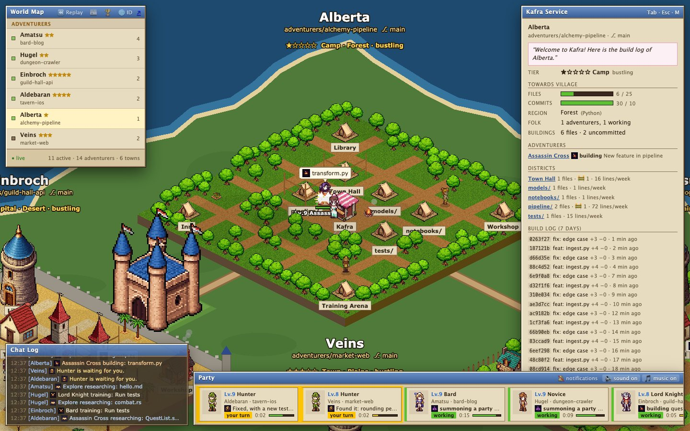 | 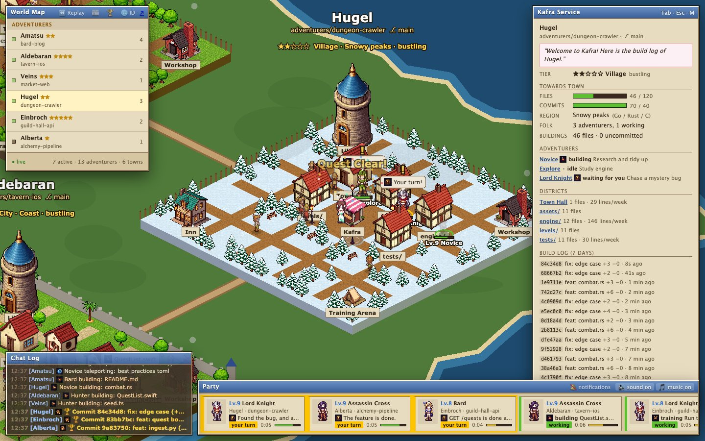 |
| **★★★★ City on the coast** | **★★★★★ Capital in the desert** |
| 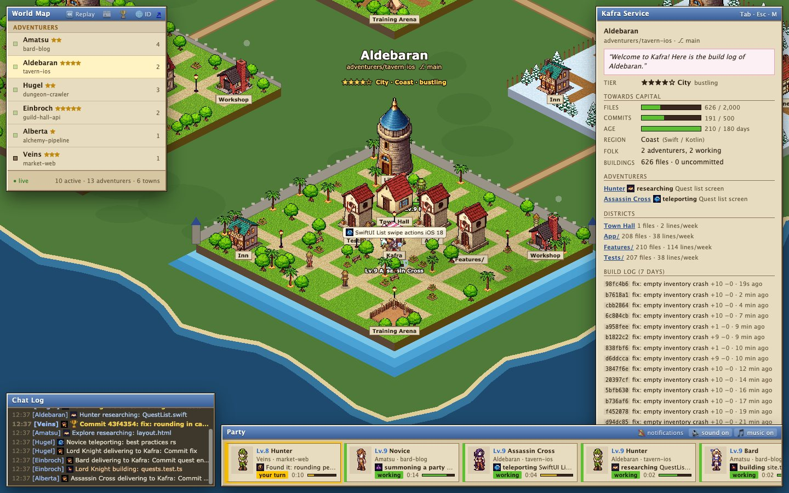 | 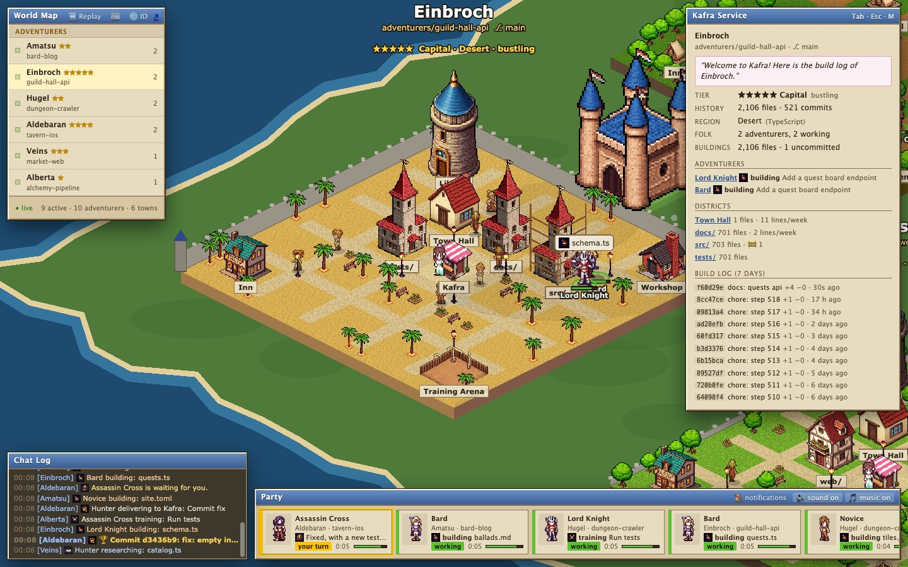 |

## ⚔️ Base levels and bugs

Every class in every town is one adventurer: all Claude Opus sessions in
`guild-hall-api` are the same Lord Knight of Einbroch, so its level keeps
climbing across sessions and days, up to Lv.99.

| Finished tool | EXP |
|---|---|
| any successful tool | +1 |
| a file built | +3 |
| a passing test run | +5 |
| a bug slain (a pass right after a failure) | +15 more |

**Bugs.** When an agent's latest test run fails, a bug appears in the Training
Arena and waits for it: a small yellow beetle, an orange horned one after two
failures in a row, a red boss after three. The agent's swings make it flinch,
and the next passing run bursts it with "Clear!".

EXP is earned while Kafra is watching, the way you only earn EXP while logged
in. With autostart on, that's always.

**Achievements.** Fourteen of them for your whole world: First Blood,
Exterminator and Bug Hunter for slaying bugs, Green Streak for five passing
runs in a row, Architect, Veteran and Hero, Full Party, Busy Guild, Multiclass,
Kingdom, City Builder, Capital, and Night Owl. An unlock shows a banner; 🏆 in
the World Map window lists them all.

## 💫 Status effects

| Ring | Meaning |
|---|---|
| 🟢 green | working |
| 🟡 **yellow, pulsing** | **waiting for you** |
| 🔴 red, pulsing | its last tool failed |
| ⚪ grey | idle |

Townsfolk are smaller and muted, and have no ring or HP bar, so you can always
tell the agents from the scenery. Zoomed out, every town turns into a pin
coloured by its most urgent agent.

| Condition | What happens |
|---|---|
| Waiting for you | alert, plus a count in the tab title and the menu bar |
| A tool failed | the town rains, and "Miss" pops up |
| A tool runs over 2 minutes | alert |
| HP below 15% | alert: the context is almost full |
| Night (by your clock) | lamps glow, and the music slows down |

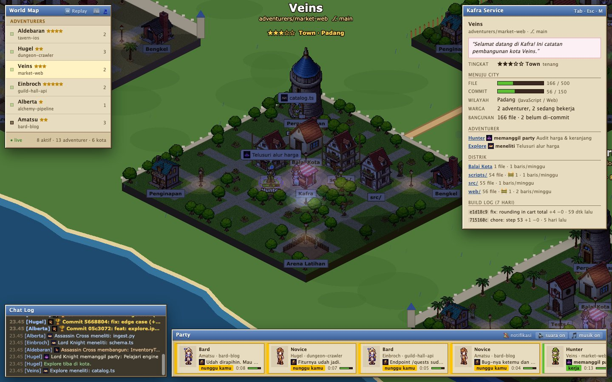

## 🎒 Items and equipment

| Item | What it does |
|---|---|
| 🧾 **Party bar** | every awake agent, with what it's running and for how long, most urgent first |
| 💬 **Chat log** | every action, failure and commit as it happens; click a line to jump there |
| ⚔️ **Menu bar** (`./kafra.sh menubar`) | `⚔ 2` in yellow means two agents are waiting; the dropdown jumps to any agent |
| 🔔 **Kafra Notifier** | a native macOS notification when an agent starts waiting; click it to open that agent. It's a tiny Swift helper built on your machine, and it only opens `127.0.0.1` links |
| 🌅 **Autostart** (`./kafra.sh autostart on`) | a per-user LaunchAgent: Kafra and SwiftBar start whenever you log in to your Mac. Logs are in `~/Library/Logs/Kafra/` |
| 🔊 **Sound and music** (🔈 / 🎵) | a sound for each skill, panned to where the agent stands, and a generative chiptune that changes with the biome. Synthesised in the browser and off by default |
| ⏪ **Replay** (`R`) | replay any day; see below |
| 📰 **Koran Kafra** | the day's newspaper; see below |

## ⏪ Replay and 📰 the daily newspaper

**Replay** plays back any day at ×10 to ×1200. Agents walk, build, fail and
commit exactly as they did, and the chat log narrates using the replay's clock.
On the slider, gold ticks mark commits and red ticks mark failures.
`● Live` brings you back to now.

**Koran Kafra** is the day on one page: a headline, who worked where, files
built, failures and fixes, commits, the best builder and the longest shift.
Click any line to jump the replay to that moment.

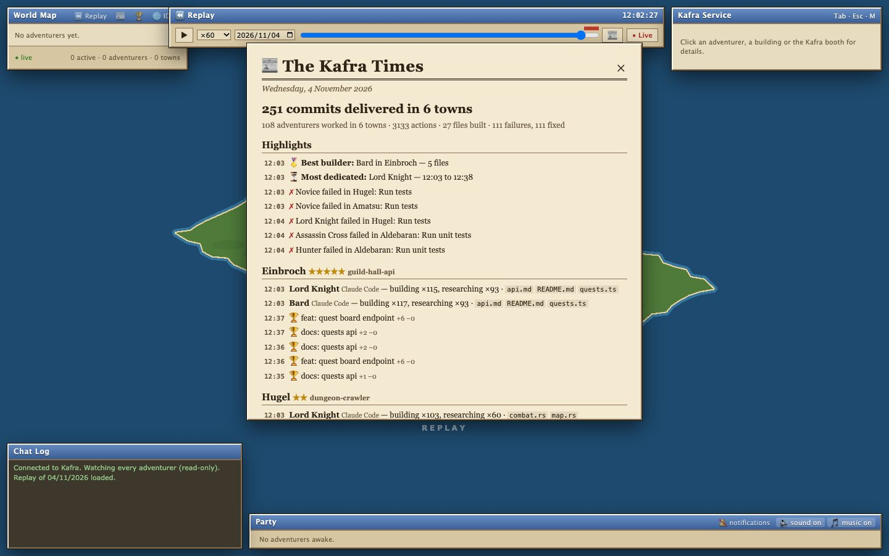

Kafra keeps no recordings of its own. A replay is rebuilt from your agents'
session files and git history, reading backwards only as far as the chosen day
(today takes about half a second). Alerts stay silent while you replay.

## 🔐 Kafra storage rules (privacy and safety)

**What Kafra reads.** Only the session files below, plus git metadata. It
never reads your files' contents, only their paths and counts.

**What Kafra writes.** One small file, `~/.config/kafra/exp.json`: EXP per
adventurer (keyed by repo path and class), the ids of each session's recent
tools so none is counted twice, a few running totals, and the dates
achievements were unlocked. No prompts, file names or code. Delete it to
start everyone again from Lv.1.

| Agent | Sessions |
|---|---|
| Claude Code | `~/.claude/projects/` |
| Codex | `~/.codex/sessions/` |
| Gemini CLI | `~/.gemini/tmp/` (its folders are hashes of the working directory; Kafra finds the folder or skips the session, and never guesses) |

`KAFRA_SOURCES=claude-code,codex` limits which sources are read, and
`KAFRA_MAX_AGE_DAYS` (default 7) sets how far back.

> ⚠️ These session files are each tool's internal format, not a public API,
> and can change with any update. If an agent stops showing up right after an
> upgrade, please [open an issue](https://github.com/isha93/kafra/issues/new?template=agent-format.yml).
> The template tells you how to share the file's structure without sharing
> your prompts.

**Hide what you don't want shown.** Copy `kafra.config.example.json` to
`kafra.config.json` in your clone (it's gitignored), or to
`~/.config/kafra/config.json` if you installed Kafra with Homebrew or npm.
Changes apply without a restart.

```json
{
  "hide": ["~/Documents/Clients/*", "secret-prototype"],
  "only": [],
  "redact": ["Acme Corp", "/internal\\.[a-z]+\\.com/"],
  "public": false
}
```

- **`hide`**: these repos never appear, and git never runs on them.
- **`only`**: when set, only these repos appear.
- **`redact`**: words (case-insensitive) or `/regex/` patterns become `••••`
  everywhere: prompts, titles, repo and branch names, and commit subjects.
  This is on top of the built-in patterns (`sk-…`, `ghp_…`, `AKIA…`,
  `token=…`, JWTs).
- **Patterns**: `*` matches within one folder, `**` across folders, `~` is
  your home folder, and a bare name matches that folder anywhere.

**Public mode** (`./kafra.sh public`) keeps the game and removes every word.
That covers the live city, the menu bar and replays. The stripping happens on
the server, so the text never reaches the browser.

**How Kafra is locked down**

| Guard | Detail |
|---|---|
| 🏠 Local only | listens on `127.0.0.1`; other machines can't reach it |
| 🌐 No other websites | wrong `Host` (DNS rebinding), cross-site `Origin`/`Sec-Fetch-Site` and anything but `GET`/`HEAD` are refused |
| 🧱 Strict CSP | scripts only from Kafra itself, no `eval`; the page can't be framed and sends no referrer |
| 📦 Zero dependencies | no npm packages at all; PixiJS (MIT) is vendored in `web/vendor/` |
| 🔒 Git, safely | `execFile` with fixed arguments and no shell; never takes `index.lock` while an agent commits; repo config can't launch programs (`core.fsmonitor`, `--no-ext-diff`, `--no-textconv`) |
| 👀 Read-only | no hooks, no writes to your agents' folders or your repos, no outbound calls |

Kafra has no login on purpose, so don't expose it to the internet. To view it
from another device, use Tailscale or an SSH tunnel.

## 📊 Character stats (resource use)

Measured on a MacBook with about 450 sessions on disk:

| Stat | Value |
|---|---|
| Disk | ~7 MB in total; the only thing Kafra saves is its EXP and achievements file, a few KB |
| Server RAM | ~75 MB live; ~130 MB with replays open (capped under autostart) |
| Server CPU | ~0–1%, with short spikes while scanning |
| Menu bar (SwiftBar) | ~80 MB RAM, ~0% CPU |
| Browser tab | the heaviest part, because it animates at 60 fps, but only while it's open |

**What runs, and when**

- **The server** idles until something asks it.
- **The menu bar** asks every 10 seconds. Kafra then reads the last 256 KB of
  each session from the past week, plus git stats cached for 10 seconds.
- **An open tab** gets an update every 2 seconds.
- **Replays** load on demand. Up to 3 days stay cached for 10 minutes.

## 🏆 Achievements

| | Achievement |
|:-:|---|
| ✅ | **Town Founder**: one repo, one town, and agents walk to their work |
| ✅ | **Master Builder**: generated pixel art for every class, building and skill |
| ✅ | **Kingdom Builder**: tiers, biomes, moods and a world map |
| ✅ | **Polyglot**: reads Claude Code, Codex and Gemini CLI |
| ✅ | **Time Mage**: replay any day, and the daily newspaper |
| ✅ | **Watchtower**: menu bar, native notifications, autostart |
| ✅ | **Bard's Song**: synthesised sound and music |
| ✅ | **Iron Wall**: DNS-rebinding guard, strict CSP, zero dependencies, public mode |
| 🔒 | **Native Hero**: a SwiftUI menu bar app with no SwiftBar needed |
| 🔒 | **Monster Hunter**: failing tests become monsters in the arena until they pass |
| 🔒 | **Hall of Fame**: achievements and levels for your own agents |
| 🔒 | **Guild Recruiter**: Aider, Cursor and OpenCode |
| 🔒 | **Commander**: approve tool calls from the city (opt-in, needs hooks) |

The full list is in [ROADMAP.md](ROADMAP.md), and what shipped when is in
[CHANGELOG.md](CHANGELOG.md).

## 🧭 For game masters

```
src/sources/          one parser per agent (claude-code, codex, gemini), merged by index.mjs
src/activity.mjs      tool → skill; redaction
src/repos.mjs         read-only git → districts, commits, growth numbers
src/growth.mjs        tier, mood and biome
src/world.mjs         sessions → towns, live and replayed
src/privacy.mjs       hide / only / redact, public mode
src/guard.mjs         host, origin and header rules
src/menubar.mjs       the SwiftBar view
src/server.mjs        /api/world/stream (SSE), /api/replay, /api/swiftbar, static files
web/city/             the PixiJS city: world, town, agent, land, replay, newspaper, audio, ui, …
web/vendor/           PixiJS, vendored
web/assets/           the generated art and its manifest
integrations/         SwiftBar plugin, Kafra Notifier
scripts/              demo, simulation, fixtures, asset generation, vendoring
```

```bash
npm start            # http://127.0.0.1:4317, no install step
npm run demo         # fixture transcripts, every animation   → :4318
npm run simulate     # six living towns in a temp folder     → :4319
npm test             # node:test, no dependencies
```

**Recruiting a new agent.** Add one file in `src/sources/` that returns the
shared session shape (see `codex.mjs`) plus a `replaySessions` for its
history, then add one line to `src/sources/index.mjs`. The city only knows
skills, never tool names, so nothing else needs to change.

**More art.** See [web/assets/README.md](web/assets/README.md) to regenerate
or replace it. To upgrade PixiJS, see `scripts/vendor-pixi.mjs`.

## 🎨 About the art, and a fan's note

**Kafra is an unofficial fan project.** It is not affiliated with, endorsed
by or connected to Gravity Co., Ltd. or Ragnarok Online. "Ragnarok Online",
"Kafra" and the class and town names used here belong to their owners and
appear only as a nod to the game this project is inspired by.

Kafra is **inspired by** Ragnarok Online, not copied from it. Every original
RO sprite, tileset, font and piece of music is copyright Gravity Co., Ltd., and
none of them are in this repo. The art here is original pixel art generated
with Retro Diffusion from prompts that never name the game or its characters,
with code-drawn fallbacks. The music is generated live in your browser. Town
names are borrowed as names only.

## 📜 License

[MIT](LICENSE). PixiJS, vendored in `web/vendor/`, is MIT-licensed by its
authors.

<div align="center">

*"Thank you for using Kafra Service. Safe travels, adventurer."* ⚔️

</div>
